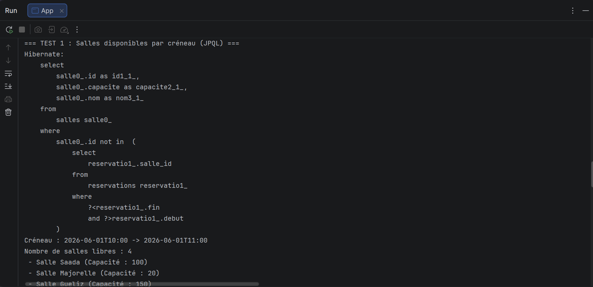
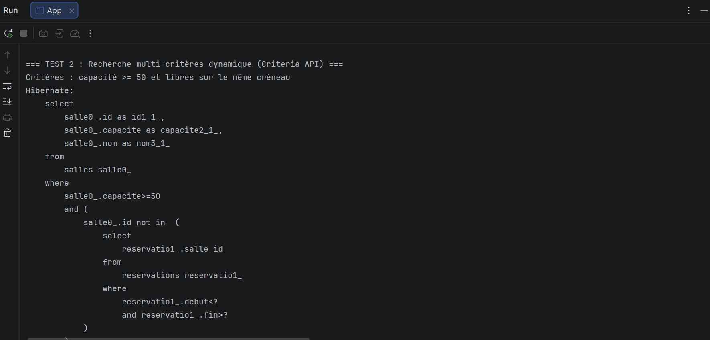
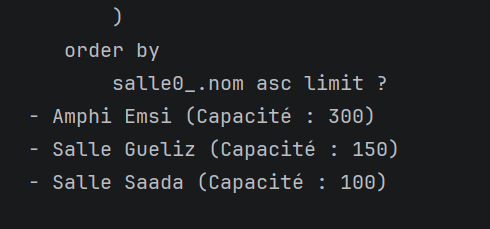
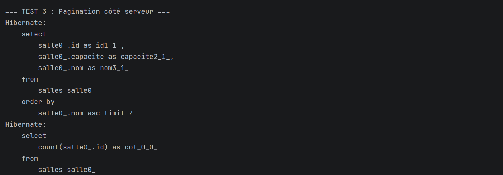

# TP 5 : Requêtes avancées avec JPA — Salles disponibles, recherche multi-critères et pagination

**Réalisé par :** Zakaria Laalyej (2DSI)

Projet réalisé dans le cadre du module JEE / Persistance des données avec Hibernate et JPA.
Il met en œuvre des requêtes avancées sur une base H2 en mémoire : vérification de disponibilité
par créneau horaire en JPQL, recherche dynamique multi-critères avec l'API Criteria, et
pagination côté serveur avec calcul du nombre total de résultats.

## Objectifs

- Écrire une requête JPQL avec sous-requête corrélée pour identifier les salles disponibles sans chevauchement de réservation.
- Construire une requête dynamique et sécurisée avec l'API Criteria (filtrage par capacité, nom et créneau).
- Mettre en place la pagination côté serveur via `setFirstResult` et `setMaxResults` et exécuter une requête `COUNT` associée.
- Structurer le code selon une architecture propre en couches : Repository, Service et classe utilitaire de pagination.

## Technologies

- Java 17
- Maven
- Hibernate 5.6 (JPA 2.2, `javax.persistence`)
- H2 (en mémoire)
- JUnit

## Modélisation des entités

```
         [Salle] 1 ──── * [Reservation]
       - id               - id
       - nom              - debut (LocalDateTime)
       - capacite         - fin (LocalDateTime)
```

- **`Salle`** : représente une salle ou un amphithéâtre (`nom`, `capacite`, `reservations`).
- **`Reservation`** : représente l'occupation d'une salle sur un intervalle temporel donné (`debut`, `fin`).
- Deux créneaux $[D_1, F_1]$ (recherche) et $[D_2, F_2]$ (existant) se chevauchent si et seulement si $D_1 < F_2$ et $F_1 > D_2$.

---

## Captures d'exécution et analyse du SQL

Au lancement de `App`, les données de test sont insérées, puis les 3 fonctionnalités sont validées dans la console (`hibernate.show_sql` et `hibernate.format_sql` activés).

### 1. Salles disponibles par créneau (JPQL)



```sql
select
    salle0_.id as id1_1_,
    salle0_.capacite as capacite2_1_,
    salle0_.nom as nom3_1_ 
from
    salles salle0_ 
where
    salle0_.id not in (
        select
            reservatio1_.salle_id 
        from
            reservations reservatio1_ 
        where
            ?<reservatio1_.fin 
            and ?>reservatio1_.debut
    )
```

- La sous-requête sélectionne les identifiants des salles qui possèdent une réservation dont le créneau chevauche l'intervalle recherché (`debutRecherche < finReservation` et `finRecherche > debutReservation`).
- La clause `where salle0_.id not in (...)` élimine ces salles occupées.
- **Résultat obtenu :** Sur le créneau `10:00 -> 11:00`, 4 salles libres sont retournées : `Salle Saada` (100 places), `Salle Majorelle` (20 places), `Salle Gueliz` (150 places) et `Amphi Emsi` (300 places). La salle déjà réservée (`Salle Atlas`) a bien été exclue.

### 2. Recherche multi-critères dynamique (Criteria API) — Construction de la requête



```sql
select
    salle0_.id as id1_1_,
    salle0_.capacite as capacite2_1_,
    salle0_.nom as nom3_1_ 
from
    salles salle0_ 
where
    salle0_.capacite>=50 
    and (
        salle0_.id not in (
            select
                reservatio1_.salle_id 
            from
                reservations reservatio1_ 
            where
                reservatio1_.debut<? 
                and reservatio1_.fin>?
        )
    )
```

- Avec **l'API Criteria**, les prédicats sont ajoutés conditionnellement en Java sans risque d'erreur de syntaxe SQL ni d'injection.
- La clause `where salle0_.capacite>=50` filtre directement les salles selon le seuil demandé.
- La sous-requête `Subquery<Long>` Criteria exclut simultanément les salles réservées sur le créneau.

### 3. Résultats de la recherche multi-critères et tri



```sql
) order by salle0_.nom asc limit ?
```

- La clause `order by salle0_.nom asc` trie les résultats par ordre alphabétique.
- La clause `limit ?` borne le résultat selon la taille de page demandée.
- **Résultat obtenu :** Les salles affichées sont `Amphi Emsi` (300), `Salle Gueliz` (150) et `Salle Saada` (100). La `Salle Majorelle` (capacité 20) est filtrée car sa capacité est inférieure à 50.

### 4. Pagination côté serveur et requête de comptage



```sql
select
    salle0_.id as id1_1_,
    salle0_.capacite as capacite2_1_,
    salle0_.nom as nom3_1_ 
from
    salles salle0_ 
order by
    salle0_.nom asc limit ?

select
    count(salle0_.id) as col_0_0_ 
from
    salles salle0_
```

- **Première requête :** récupère uniquement le sous-ensemble de données pour la page demandée (`limit` et `offset` gérés par `setFirstResult` et `setMaxResults`).
- **Deuxième requête :** exécute un `count(salle0_.id)` avec les mêmes filtres afin de calculer le nombre total de pages ($\lceil \text{total} / \text{taille} \rceil$) pour les contrôles de navigation de l'utilisateur.

---

## Architecture de l'application

- **`SalleRepository` / `SalleRepositoryImpl`** : encapsulation pure de l'accès aux données (requêtes JPQL et Criteria API via l'`EntityManager`).
- **`SalleService` / `SalleServiceImpl`** : couche métier orchestrant les appels et appliquant les règles de gestion.
- **`PaginationResult<T>`** : objet de transfert générique regroupant les données paginées (`items`, `currentPage`, `pageSize`, `totalPages`, `totalItems`).

---

## Structure du projet

```
tp5-requetes-avancees/
├── pom.xml
├── README.md
├── captures/
│   ├── app-test1-salles-disponibles.png
│   ├── app-test2-criteria-requete.png
│   ├── app-test2-criteria-resultats.png
│   └── app-test3-pagination.png
└── src/
    ├── main/
    │   ├── java/com/example/
    │   │   ├── App.java
    │   │   ├── model/
    │   │   │   ├── Salle.java
    │   │   │   └── Reservation.java
    │
